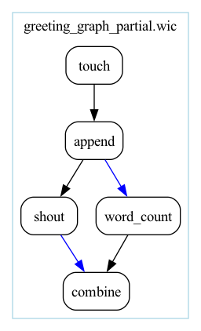

# Edge inference

Workflows are graphs, but long stretches of most of them are straight
lines, where each step reads what the step before it wrote. Writing every one
of those edges down, as you have done so far, says nothing a reader
could not guess. In this chapter you will delete the
edges from the greeting workflow and let Sophios fill them in. This is
called **edge inference**. You will see the note Sophios prints when it had
a choice to make, learn the rule it follows, and learn how to take the
choice back when it is not the one you want.

## Leave the edges out

Here is the greeting workflow with every edge deleted. Save it as
`greeting_inferred.wic`, and the Python form as `greeting_inferred.py`:

```{literalinclude} cookbook/greeting_inferred.wic
:language: yaml
:caption: greeting_inferred.wic
```

```{literalinclude} cookbook/greeting_inferred.py
:language: python
:caption: greeting_inferred.py
```

Nothing says which file `append` writes to or which file `cat` reads. Run
either form:

```bash
sophios --yaml greeting_inferred.wic --run_local
```

```bash
python greeting_inferred.py
```

Both succeed, and `greeting.txt` holds `Hello, Sophios`, exactly as before.
Sophios connected `append`'s `file` to the file `touch` made, and `cat`'s
`file` to the file `append` wrote. The compiled workflow is the one you
wrote by hand in chapter 1.

Both also printed a note on stderr before the run:

```text
note [wic043] 1 edge was guessed; draw the workflow to check it (--graphviz, or Workflow.draw() in Python)
  greeting_inferred.wic:8:3  cat.file <- append.file (1 other fits)
```

## Read the note

A **note** is Sophios telling you about a choice it made. It never stops
anything. This one, `wic043`, lists the edges Sophios guessed: inputs that
another output would also have fitted. The first line counts them and says
how to check them. Each row under it is one edge, in three parts:

- **where:** `greeting_inferred.wic:8:3`, the `cat` step;
- **the edge:** `cat.file <- append.file`, `cat`'s `file` reads `append`'s `file`;
- **what else fit:** one other output, `touch`'s `file`, which is also a file.

The step and port names are the ones you wrote. An output inside a workflow
used as a step is named by the steps down to it, as `sub.wic/inner.file`, and
a step whose name repeats in its workflow carries its position, as
`touch@2`, as in the compiled CWL.

`append`'s own input gets no row: only one earlier step, `touch`, made a
file, so there was nothing to choose.

To see which step reads which, draw the workflow: `--graphviz` on the
command line, or `Workflow.draw()` in Python, as [Drawing](drawing.md)
shows. When an error stops the compile there is nothing to draw, and the
first line only counts the edges.

The Python API prints the same note on stderr when you compile or run, each
row at the line of your script that made the step, and keeps one
`Diagnostic` per edge on the result, so code can read the data rather than
the text:

```python
from greeting_inferred import workflow

compiled = workflow().compile()
for note in compiled.diagnostics:
    print(note.code, note.message)
```

```text
note [wic043] 1 edge was guessed; draw the workflow to check it (--graphviz, or Workflow.draw() in Python)
  /home/you/sophios-tutorial/greeting_inferred.py:17:1  cat.file <- append.file (1 other fits)
wic043 cat.file <- append.file (1 other fits)
```

The first two lines are the compile's stderr; the last one is the `print`. A
run returns its notes the same way, as `diagnostics` on the `RunResult`.

## Choose yourself

When the choice is the wrong one, or when it matters enough that a reader
should see it in the file, write the edge. In `.wic`, mark the output with
`!&` and read it with `!*`, as in `out: - file: !& greeting_file` on `append`
and `in: file: !* greeting_file` on `cat`; that is exactly what
`greeting.wic` from chapter 1 does. In Python, write the assignment,
`cat.inputs.file = append.outputs.file`. Sophios never infers an input you connected, so the
note goes away, and connecting one input changes nothing for the others.
You can mix the two freely: write the edges that matter and leave the
rest.

To make Sophios refuse to guess, turn every guessed edge into an error. On the
command line that is `--inference_strict`; in Python it is
`Inference(strict=True)`, from `sophios.api.python.workflow`, given to
`compile()` or `run()`:

```bash
sophios --yaml greeting_inferred.wic --generate_cwl_workflow --inference_strict
```

```text
Failed to compile greeting_inferred.wic
greeting_inferred.wic:8:3: error [wic043] cat.file <- append.file was guessed, 1 other fits; write the edge it should read
```

```python
from sophios.api.python.workflow import Inference

from greeting_inferred import workflow

workflow().compile(inference=Inference(strict=True))
```

In Python, `compile()` raises `SophiosError` with the same error, at the line
of your script that made `cat`:

```text
sophios.lang.diagnostics.SophiosError: /home/you/sophios-tutorial/greeting_inferred.py:17:1: error [wic043] cat.file <- append.file was guessed, 1 other fits; write the edge it should read
```

Use it for a workflow that must not depend on the order of its steps. To
turn inference off altogether, use `--inference_disable`, or
`Inference(enabled=False)`. An input nothing connects then stays
unconnected, and the runner refuses the workflow before any step runs:

```text
ERROR Tool definition failed validation:
autogenerated/greeting_inferred.cwl:20:3: Step is missing required parameter 'file'
```

## The rule

For each step, in order, and for each of its inputs that is required and
has no value and no edge, Sophios looks back through the earlier
steps, the most recent first, for an output that fits:

1. An output fits when its type matches the input's type, and its file
   format matches the input's when the input declares one. `File` matches
   `File`; an optional `File?` matches `File`; `Any` matches only `Any`. No
   output is left out because of its name: a log is a `File` like any other.
   An input that declares a format never reads a `File` output that declares
   none, so one `format:` on the input keeps logs out.
2. The most recent step with a fitting output wins. Within that step, an
   output whose name pairs with the input's wins, as the next section shows;
   if none does, the output declared first wins.
3. If another output also fitted, from an earlier step or from the winning
   step itself, Sophios notes the edge as a guess, `wic043`.
4. If nothing fits, the input becomes an input of the compiled workflow, for
   the run to supply, and the runner asks for it.
5. A duplicate needs evidence. When two or more inputs of one tool step read
   the same output and at least one of them was inferred, Sophios refuses,
   as `wic055`, unless every one of those inputs declares file formats and
   the output's format is among them. The inferred inputs are then not
   connected. A file read by several steps, or by several steps inside one
   subworkflow, is not a duplicate: the rule counts the inputs of one tool
   step. Two edges you wrote are never refused.

Optional inputs are never inferred. Inference also reaches into a workflow
used as a step and out of it, as [Subworkflows](subworkflows.md) shows. The
complete rule, with how types, formats and scattered steps are compared, is
[§8 of the `.wic` reference](wic-reference.md#8-inference).

## When the graph branches

Each step reads from the nearest step above it that makes the right kind of
file. When a step should read from further up, write that edge.

Inference reads your list of steps in order; it cannot know that two steps
were meant to sit side by side. Here is the greeting graph from
[Connecting steps](connecting-steps.md) with every edge deleted:

```{literalinclude} cookbook/greeting_graph_inferred.wic
:language: yaml
:caption: greeting_graph_inferred.wic
```

```{literalinclude} cookbook/greeting_graph_inferred.py
:language: python
:caption: greeting_graph_inferred.py
```

Neither form compiles. `word_count` would read `shout`'s file, the nearest
file above it, instead of the greeting, and then `combine` would read the
counts twice, as its `text` and as its `counts`. Sophios stops there:

```text
greeting_graph_inferred.wic:12:3: error [wic055] combine.text and combine.counts would both read word_count.counts; write the edge each should read
note [wic043] 2 edges were guessed:
  greeting_graph_inferred.wic:8:3   shout.text <- append.file (1 other fits)
  greeting_graph_inferred.wic:10:3  word_count.text <- shout.shouted (2 others fit)
```

The error comes first, then the edges inference guessed on the way to it; the
two the error names are not repeated. In Python, `compile()` and `run()`
raise `SophiosError` with the same lines, the error at the line of your
script that made `combine`:

```text
sophios.lang.diagnostics.SophiosError: /home/you/sophios-tutorial/greeting_graph_inferred.py:19:1: error [wic055] combine.text and combine.counts would both read word_count.counts; write the edge each should read
note [wic043] 2 edges were guessed:
  /home/you/sophios-tutorial/greeting_graph_inferred.py:17:1  shout.text <- append.file (1 other fits)
  /home/you/sophios-tutorial/greeting_graph_inferred.py:18:1  word_count.text <- shout.shouted (2 others fit)
```

Write the edge each input should read, as `in: text: !* shouted` and
`in: counts: !* counts` on `combine`, with `out: - shouted: !& shouted` and
`out: - counts: !& counts` on the steps that make them.

Two inputs of one step that read the same file are almost always a mistake,
and nothing in the file says this one is meant. Sophios accepts it only when
the tool says so: when both inputs declare file formats and the file's
format is one of them, as with a tool whose two inputs both take a table.
Two edges you wrote yourself are never refused.

The fix is to write the two edges that decide the graph, the one at the
branch and the one at the join, and leave the rest to inference. Here
`word_count` reads `append`'s file, and `combine` reads `shout`'s:

```{literalinclude} cookbook/greeting_graph_partial.wic
:language: yaml
:caption: greeting_graph_partial.wic
```

```{literalinclude} cookbook/greeting_graph_partial.py
:language: python
:caption: greeting_graph_partial.py
```

Both forms compile to the graph of `greeting_graph.wic`. Inference fills in
three edges: `append`'s file from `touch`, `shout`'s text and `combine`'s
counts. It notes the last two as the guesses they are, and says how to check them:

```text
note [wic043] 2 edges were guessed; draw the workflow to check them (--graphviz, or Workflow.draw() in Python)
  greeting_graph_partial.wic:10:3  shout.text <- append.file (1 other fits)
  greeting_graph_partial.wic:18:3  combine.counts <- word_count.counts (3 others fit)
```

Drawn, the graph is the diamond, with the edges you wrote in blue and the
edges Sophios inferred in black:



The error caught this graph only because `combine` joins both branches. A
branch that never joins still compiles, with its input read from the nearest
file above it and nothing to say it is the wrong one. Read the notes, or draw
the workflow before a long run: the drawing shows at once which step reads
which. Write the edges wherever the graph branches or joins, as
`greeting_graph.wic` does, and leave the straight stretches to inference.

## When names should decide

Types cannot always decide. A step often makes two files, and a later step
wants one of them. Here a `summarize` step writes a one-line summary of a
text and a line-numbered copy of it, as `output_details` and
`output_summary`, and a `report` step wants the summary, on its input
`input_summary`. Save the two tools beside your workflows:

```{literalinclude} cookbook/summarize.cwl
:language: yaml
:caption: summarize.cwl
```

```{literalinclude} cookbook/report.cwl
:language: yaml
:caption: report.cwl
```

The two steps that use them say `run: summarize.cwl` and `run: report.cwl`:
a tool named by its file, beside the workflow, instead of by a name Sophios
looks up. In Python, `Path(__file__).with_name('summarize.cwl')` is the same
file, beside the script. [Steps and tools](steps-and-tools.md) explains both
ways of naming a tool; here they only keep the two new tools next to the
workflow. Save the workflow, with every edge left to inference:

```{literalinclude} cookbook/naming.wic
:language: yaml
:caption: naming.wic
```

```{literalinclude} cookbook/naming.py
:language: python
:caption: naming.py
```

### The name decides

Both of `summarize`'s outputs are files, so by type they tie. Run
`sophios --yaml naming.wic --run_local`, or `python naming.py`. Among tied
outputs of the same step, Sophios takes the one whose name pairs with the
input's. It strips `input_` from the input's name and `output_` from each
output's, so `input_summary` pairs with `output_summary`. The names never
move the choice to another step: the most recent step with a fitting output
still wins. A call to a
subworkflow counts as one step here, so names choose among the outputs of the
steps inside it, and may pick one that is not from its most recent inner step.
One note remains, as `echo`'s file came earlier and also fits; the most recent
step won, which is the choice you want:

```text
note [wic043] 1 edge was guessed; draw the workflow to check it (--graphviz, or Workflow.draw() in Python)
  naming.wic:7:3  report.input_summary <- summarize.output_summary (1 other fits)
```

`report.txt` holds the summary, the text's word count:

```text
9
```

When no output's name pairs with the input's, or several do, the output
declared first wins.

### Turning the names off

If your tools' names mean nothing, or you want the plain rule, switch the
names off with `--no_inference_naming_conventions` on the command line or
`Inference(naming_conventions=False)` in Python:

```bash
sophios --yaml naming.wic --run_local --no_inference_naming_conventions
```

```python
from sophios.api.python.workflow import Inference

from naming import workflow

workflow().run(inference=Inference(naming_conventions=False))
```

By type alone the tie goes to the output declared first, `output_details`, and
the command line says so:

```text
note [wic043] 1 edge was guessed; draw the workflow to check it (--graphviz, or Workflow.draw() in Python)
  naming.wic:7:3  report.input_summary <- summarize.output_details (2 others fit)
```

`report.txt` then holds the line-numbered copy, not the summary:

```text
     1	The quick brown fox jumps over the lazy dog
```

### A renaming, when the names follow different conventions

Tools from different groups rarely agree on names. Suppose the step that
wants the summary calls it an abstract, on an input `input_abstract`:

```{literalinclude} cookbook/abstract.cwl
:language: yaml
:caption: abstract.cwl
```

```{literalinclude} cookbook/naming_renamed.wic
:language: yaml
:caption: naming_renamed.wic
```

```{literalinclude} cookbook/naming_renamed.py
:language: python
:caption: naming_renamed.py
```

`abstract` pairs with neither output, so the names alone fall back to the
output declared first, `output_details`. A **renaming** tells Sophios how
the two conventions correspond. It is a `[before, after]` pair, applied to
the input's name, after `input_` is stripped and before the names are
compared: with `['abstract', 'summary']`, `input_abstract` pairs with
`output_summary`. When the renamed name pairs with no output, the input's own name is tried, so
`input_structure_file` still pairs with `output_structure_file`. On the command line, add the pair to `renaming_conventions`
in `~/wic/global_config.json`:

```json
"renaming_conventions": [
    ["energy_", "edr_"],
    ["structure_", "tpr_"],
    ["traj_", "trr_"],
    ["abstract", "summary"]
]
```

and run it:

```bash
sophios --yaml naming_renamed.wic --run_local
```

In Python, give the pair to `Inference`. A pair you give replaces the three
Sophios ships, which Python otherwise starts from, as the command line does:

```python
from sophios.api.python.workflow import Inference

from naming_renamed import workflow

workflow().run(inference=Inference(renamings=(('abstract', 'summary'),)))
```

```text
note [wic043] 1 edge was guessed; draw the workflow to check it (--graphviz, or Workflow.draw() in Python)
  naming_renamed.wic:7:3  abstract.input_abstract <- summarize.output_summary (1 other fits)
```

and `abstract.txt` holds the summary, `9`, from either form. Renamings are
part of the naming conventions, so `Inference` refuses them when the
conventions are off:

```text
sophios.api.python._errors.InvalidInferenceError: error [api007] Inference.renamings is given but naming_conventions is False, so the renamings would do nothing
error [api007] set naming_conventions=True, or drop renamings
```

`InvalidInferenceError` is importable from `sophios.api.python.workflow`,
like the other API errors. The three pairs already in the configuration are
GROMACS conventions, for the molecular-modelling tools Sophios's own tool
collections hold, which call one file `energy` on one side and `edr` on the
other.

### Conventions or a written edge?

For one edge in one workflow, write it with `!&` and `!*`, or an
assignment in Python: it is shorter than a convention, and a reader sees it
where it happens. Naming conventions pay off when a whole collection of tools
follows one naming scheme and many workflows are built from them: name the
ports `input_<thing>` and `output_<thing>`, add a renaming for each place
two schemes meet, and every workflow connects them without a written line.

One more refinement exists for collections whose file formats are declared:
`--insert_steps_automatically`, `insert_steps=True` in Python, inserts a
converter step when no output's format fits, steered by the configuration's
`inference_rules`, `format_rules=` in Python. Python reads no configuration:
its format rules are empty unless you pass them, its renamings start from the
three Sophios ships, and it inserts
only the converters among the tools in `tool_registry=`, where the command
line searches every tool on its search paths. The rules are read only for an
inserted step, so `format_rules=` without `insert_steps=True` is an error
(`api007`).
[Configuration](configuration.md) and
[§8 of the `.wic` reference](wic-reference.md#8-inference) describe it.

## Recap

Leave out an input's edge and Sophios connects it to the most recent
earlier output that fits, unless that would give two inputs of one step the
same file with nothing to say so (`wic055`). When another output also fitted, it lists the
edge in a note, `wic043`, and says how to draw the workflow and check it. Write an edge to
choose for yourself. `--inference_strict`, or
`Inference(strict=True)` in Python, forbids choices, and
`--inference_disable`, or `Inference(enabled=False)`, turns inference off.
When outputs tie by type, naming conventions let names decide, with
renamings where two naming schemes meet.

## Next

So far the steps have run tools that ship with Sophios, or small tool files
beside the workflow that you saved and named with `run:`. In
[Steps and tools](steps-and-tools.md) you will see where Sophios finds
tools, use one tool twice under two names, and add a tool of your own.
